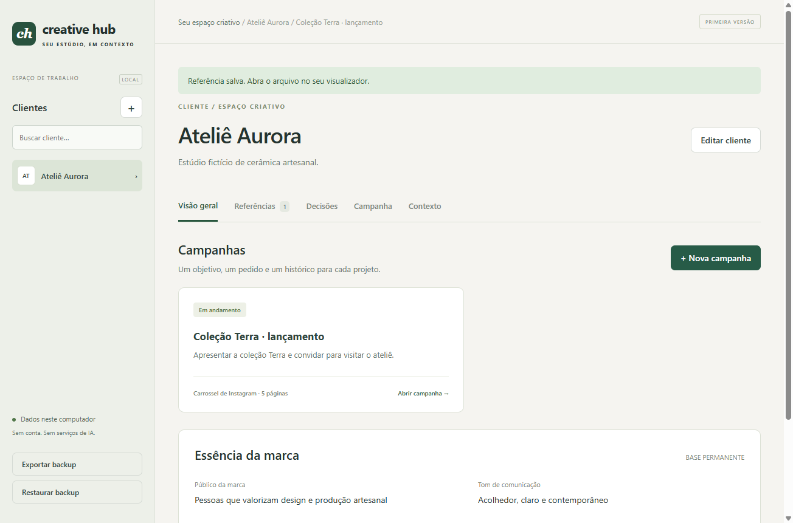
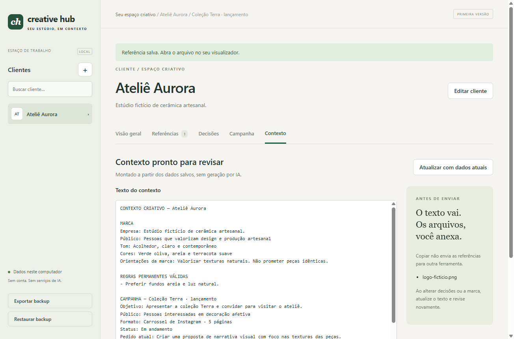

# AI Creative Hub Desktop

**Em desenvolvimento — primeira versão funcional**

Versão **0.2.0**: back-end Java 17, mantendo React/TypeScript e o aplicativo desktop Electron.

Um espaço local para organizar clientes, campanhas, referências e decisões e preparar um contexto consistente para usar em diferentes ferramentas de IA.

## Por que existe

Na criação de artes, repetir o briefing em várias ferramentas pode fazer informações importantes se perderem. O AI Creative Hub mantém os dados da marca e o histórico das orientações juntos, por cliente e campanha. A utilidade desta primeira versão ainda será validada no fluxo real de trabalho.

O aplicativo funciona sem API, modelo local, conta ou conexão depois de instalado. Não gera textos ou imagens por inteligência artificial: organiza informações fornecidas pelo usuário com regras explícitas.

## Interface real

Capturas do aplicativo Electron durante o teste automatizado. **Ateliê Aurora é um cliente fictício**; a instalação começa vazia.





## O que funciona

- Cadastro e edição de clientes: empresa, público, tom, cores e orientações da marca; busca por nome.
- Referências por cliente: PNG, JPG, WEBP e PDF. Imagens têm prévia ampliada; qualquer referência pode ser salva como cópia. PDFs são consultados no visualizador externo depois de salvar a cópia.
- Campanhas com título, objetivo, público, formato, pedido e status.
- Orientações permanentes do cliente e decisões específicas de campanha.
- Correção e invalidação com motivo e data, mantendo o registro anterior no histórico.
- Contexto determinístico usando a marca, a campanha escolhida e somente decisões válidas. Rascunho editável, salvável e copiável.
- Relação das referências que devem ser anexadas manualmente. **Copiar o texto não envia arquivos para outra IA.**
- Persistência local entre sessões e backup completo, incluindo os bytes dos anexos.
- Importação validada, com confirmação da substituição e cópia local dos dados anteriores.
- Interface em português brasileiro, estados vazios e mensagens de erro.

## Exemplo de uso

1. Cadastre o cliente e preencha as informações da marca.
2. Em **Referências**, adicione logos e exemplos aprovados.
3. Crie uma campanha com o pedido atual.
4. Em **Decisões**, registre regras permanentes ou orientações exclusivas da campanha aberta.
5. Abra **Contexto → Atualizar com dados atuais**. Revise o texto, edite se necessário, salve o rascunho e copie.
6. Na ferramenta escolhida, cole o texto e anexe as referências separadamente.
7. Registre as próximas decisões. Use **Corrigir** ou **Invalidar** quando uma orientação deixar de valer e atualize o contexto novamente.

O rascunho é uma versão revisada manualmente: mudanças na marca ou nas decisões não o substituem automaticamente. O botão de atualização pede confirmação antes de sobrescrever edições.

## Baixar para Windows

As distribuições ficam na [página de versões](https://github.com/JuliaRomeira/ai-creative-hub-desktop/releases). A versão **0.2.0 exige Java 17 ou superior instalado**, disponível pelo `PATH` ou por `JAVA_HOME`. O executável inclui o back-end compilado, mas não inclui o ambiente Java. Node.js e Maven não são necessários para usar o executável.

Abra apenas o `.exe`: ele inicia a interface e o Java automaticamente. O aplicativo não é assinado digitalmente e não possui atualizador automático. A distribuição antiga **0.1.0 não usa Java**.

## Instalar e executar pelo código

Requisitos: Windows, Git, Node.js **22.12 ou superior** e **JDK 17 ou superior** (incluindo `javac`). Validado localmente com Node.js 24.22.1 e JDK 17.0.12. Use uma distribuição JDK atualizada da linha 17 ou superior. Maven é baixado automaticamente pelo wrapper do projeto; não é necessário instalar Maven globalmente. A primeira instalação precisa de internet para baixar dependências, Maven e Electron.

```powershell
git clone https://github.com/JuliaRomeira/ai-creative-hub-desktop.git
cd ai-creative-hub-desktop
npm ci
npm start
```

`npm start` compila o Java em um JAR, verifica o TypeScript, compila a interface e abre o Electron. O Electron inicia `java -jar` e aguarda a resposta de inicialização antes de abrir a janela. Ao fechar o aplicativo, encerra a comunicação e o Java libera o arquivo de bloqueio e sai. Não é um site hospedado e não exige servidor ou chave de API.

Se o Java não for encontrado, confira `java -version` e `javac -version` em um novo terminal. `JAVA_HOME`, quando configurado, deve apontar para a pasta do JDK, não para `bin`. Não é necessário iniciar dois terminais nem abrir o back-end manualmente.

Para gerar a distribuição portátil do Windows:

```powershell
npm run package
```

O executável é gerado em `release/`. Não é assinado digitalmente. A distribuição portátil também guarda os dados no perfil do Windows, não ao lado do executável. Não há atualizador automático.

## Dados e backup

O Java salva `workspace/workspace.json` no diretório informado pelo Electron, mantendo o mesmo `userData` da versão anterior. No Windows, o caminho padrão é:

```text
%APPDATA%\ai-creative-hub-desktop\workspace\workspace.json
```

Os anexos são copiados para a base em Base64; o arquivo original pode ser movido ou removido. A gravação usa arquivo temporário, sincronização em disco e substituição atômica com Java NIO. Se o sistema de arquivos não permitir substituição atômica, a operação falha em vez de usar uma gravação menos segura. Uma cópia `workspace.json.previous` guarda o estado anterior à última gravação. O Electron limita as instâncias, e o Java também mantém um bloqueio de arquivo para evitar dois escritores na mesma base.

**Exportar backup** salva um JSON com clientes, campanhas, decisões, rascunhos e anexos. Guarde uma cópia fora do computador. **Restaurar backup** valida a versão e as relações antes de substituir a base; não mescla dados. Uma cópia `workspace.json.before-restore-*` preserva o estado anterior à restauração, além da cópia da última gravação.

Se a base não puder ser lida, o aplicativo exibe o erro sem reinicializá-la. É possível restaurar um backup pelo menu lateral. Para recuperar uma cópia automática, selecione uma cópia dela com extensão `.json` no importador. A base e os backups **não são criptografados**; proteja esses arquivos como qualquer documento de cliente.

Limites explícitos da primeira versão: **10 MB por referência e 100 MB para a base/backup JSON**, incluindo o aumento de tamanho do Base64. Esta arquitetura prioriza uma base pequena e simples; não é destinada a bibliotecas grandes de mídia.

### Compatibilidade com a versão anterior

Não há conversão de banco: o contrato JSON continua com `version: 1`. Clientes, campanhas, decisões, datas, rascunhos e anexos existentes são lidos pelo Java. Apenas abrir a base não a regrava.

Antes da primeira gravação Java sobre um arquivo existente, é criada a cópia **`workspace.json.before-java-v020`**, preservando os bytes originais. Ela não é sobrescrita por edições seguintes. A base fictícia gerada pela implementação 0.1.0 foi usada nos testes de compatibilidade; nenhum banco pessoal foi usado nos testes. Exporte um backup antes de atualizar, feche a versão anterior e não execute versões diferentes simultaneamente sobre a mesma base.

Para recuperar o estado anterior, faça uma cópia do snapshot para outra pasta, acrescente a extensão `.json` e use **Restaurar backup**. Restauração substitui os dados atuais, não mescla as alterações feitas depois.

## Arquitetura

| Camada | Responsabilidade |
| --- | --- |
| React + TypeScript, em `src/` | Formulários, navegação e revisão do texto retornado pelo Java |
| Electron, em `electron/main.cjs` | Janela, diálogos de arquivo, área de transferência e ciclo de vida do Java |
| Preload isolado | Ponte restrita entre a interface e o processo principal |
| `electron/java-backend.cjs` | Transporte de pedidos e respostas, detecção de falhas e prazo de resposta |
| Java, em `backend/src/main/java/` | Modelos, validação, cadastros, histórico, anexos, persistência e preparação de contexto |
| Gson | Leitura e escrita JSON compatível com os arquivos anteriores |
| Maven Wrapper | Compilação, dependências Java, JUnit e empacotamento do JAR |
| Vite | Compilação local da interface |
| JUnit + Node Test + Playwright | Regras Java, comunicação entre processos e fluxos no Electron real |

A interface não acessa o Node diretamente: usa isolamento de contexto, sandbox e uma ponte limitada. Navegações e novas janelas são bloqueadas; a política de conteúdo não permite conexões externas. A implementação antiga de armazenamento Node e a montagem de contexto em TypeScript foram removidas, evitando regras duplicadas.

```text
React/TypeScript → preload → Electron → stdin/stdout → Java
                                                      ├─ WorkspaceService
                                                      ├─ ContextService
                                                      ├─ WorkspaceValidator
                                                      └─ WorkspaceRepository → JSON local
```

Cada pedido e resposta ocupa uma linha JSON com identificador. O canal são os pipes privados do processo filho: **não há HTTP, porta aberta, API externa ou serviço em nuvem**. Os caminhos escolhidos nos diálogos nativos são encaminhados ao Java, responsável por validar e ler/gravar os arquivos. O back-end executa os pedidos em sequência para evitar gravações concorrentes.

**Por que sem Spring Boot?** O produto atual é local, monousuário e não precisa de servidor HTTP. Java puro com Maven e Gson reduz a configuração e deixa classes, coleções, validação, exceções e persistência visíveis para estudo. Spring Boot faria sentido se surgir uma necessidade concreta de API compartilhada, autenticação ou aplicação web. Ele não é necessário para praticar Java nesta etapa.

## Por onde estudar Java

Abra `backend/pom.xml` no IntelliJ como projeto Maven e selecione JDK 17 ou superior. Siga o [roteiro de estudo Java](docs/ESTUDAR-JAVA.md), começando pelos modelos e pelo `ContextService`, antes de avançar para persistência e comunicação entre processos.

## Verificação

```powershell
npm run check
npm audit
npm run package
```

O teste end-to-end abre o Electron, preenche a interface e usa diretórios temporários com dados fictícios. As caixas nativas de seleção de arquivo e confirmação são substituídas por respostas determinísticas durante o teste; a leitura, gravação e restauração dos arquivos são reais.

`npm run check` executa **9 testes JUnit, 3 testes da ponte Node/Java e 3 fluxos end-to-end**, além da compilação Java/TypeScript. Para estudar somente o Java: `npm run test:java` ou, dentro de `backend`, `.\mvnw.cmd test`.

Depois de empacotar, execute os mesmos fluxos contra o **portátil real**, em PowerShell:

```powershell
$env:AICH_EXECUTABLE = (Resolve-Path 'release\AI Creative Hub 0.2.0.exe').Path
try { npx playwright test } finally { Remove-Item Env:AICH_EXECUTABLE }
```

O teste inicia o lançador NSIS e verifica que a aplicação está empacotada e foi aberta pelo portátil. Uma ponte em `tests/portable-launch.*` repassa ao Playwright os endereços de diagnóstico que o NSIS não encaminha pela saída padrão. As portas de diagnóstico são usadas somente nesta execução de teste, em loopback; o aplicativo aberto normalmente não as habilita. Os diálogos nativos continuam simulados. O GitHub Actions executa essa validação e disponibiliza o `.exe` como artefato por 7 dias, somente após os testes passarem.

Em 31/10/2026, `npm audit --omit=dev` não apontou vulnerabilidades. A auditoria completa apontou 15 alertas moderados na cadeia de desenvolvimento do `electron-builder`, derivados de `minimatch`. A sugestão automática exige regressão para uma versão antiga do empacotador; não foi aplicada. Esses alertas continuam pendentes de uma correção compatível dos fornecedores.

Cobertura da entrega:

- Cadastro e edição de cliente e campanha.
- Orientações permanentes e de campanha, correção e invalidação preservando o histórico.
- Exclusão de decisões antigas do contexto e manutenção das válidas.
- Edição e persistência do rascunho e cópia para a área de transferência do sistema.
- Encerramento e nova abertura do Electron com dados e rascunho preservados.
- Anexo original removido e cópia salva após reinício, com comparação byte a byte.
- Exportação e restauração em perfil vazio, incluindo anexos e histórico.
- Rejeição de backup malformado sem perda da base atual.
- Base corrompida preservada, cancelamento de restauração sem gravação e recuperação por backup com snapshot dos bytes anteriores.
- Validação de referências órfãs, identificadores duplicados, versões desconhecidas e limite por anexo.
- Compilação TypeScript e verificação de ausência de rolagem horizontal em janela de 900 × 700.
- Base 0.1.0 aberta sem regravação e snapshot original comparado byte a byte após editar pelo Java.
- Separação do contexto por campanha, preservando regras permanentes.
- Inicialização/encerramento do Java, comunicação concorrente, Java ausente e queda do processo.
- Bloqueio de segundo escritor e proteção contra exportação sobre o arquivo interno.

As capturas em `docs/` são geradas pelo próprio teste. Bancos, backups, dependências, executáveis e resultados temporários não entram no Git.

## Limitações e próximos passos

- Validação de uso cotidiano ainda pendente com o profissional de criação.
- Sem geração de imagem, IA integrada, login, cobrança ou sincronização em nuvem.
- Sem exclusão de clientes, campanhas ou referências nesta primeira versão; decisões podem ser invalidadas.
- O histórico versiona orientações; edições dos campos de cliente e campanha substituem os valores anteriores.
- PDFs não têm visualizador embutido. Use **Salvar cópia** e abra no leitor de PDF.
- Armazenamento JSON com anexos em memória durante o uso, adequado a projetos pequenos dentro dos limites acima.
- Distribuição Windows sem assinatura; macOS e Linux não foram validados.
- O ambiente Java não é incluído no executável; instalação de Java 17+ é requisito real.
- Bibliotecas grandes de mídia e uso prolongado com base próxima do limite ainda não foram validados. A JVM tem limite de heap de 512 MB e o armazenamento atual mantém o documento em memória.

### Roadmap — ainda não implementado

- IA local opcional.
- Revisão assistida de briefing.
- Busca de contexto relevante.
- Agentes com ferramentas.
- Integrações opcionais por API.
- Evolução do armazenamento e do empacotamento após o uso real.
- Distribuição com ambiente Java incluído, após definir tamanho e manutenção das atualizações.

## Referências técnicas

[Segurança no Electron](https://www.electronjs.org/docs/latest/tutorial/security) · [Testes Electron com Playwright](https://playwright.dev/docs/api/class-electron) · [Maven Wrapper](https://maven.apache.org/tools/wrapper/)
